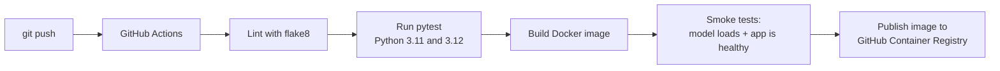

# 🏦 Loan Approval Prediction — ML app with a DevOps pipeline

A machine learning web app (Streamlit + scikit-learn) that predicts whether a loan application
is likely to be approved. The project also includes a complete **DevOps workflow**:
automated tests, Docker, and a CI/CD pipeline built with GitHub Actions.

> ⚠️ For educational purposes only. Not real financial advice.

**Live demo:** _add your Streamlit Cloud link here_

## What the DevOps part does



| Practice | Tool | Where |
|---|---|---|
| Automated tests | pytest | `tests/` |
| Code quality checks | flake8 | `.flake8` |
| Containerization | Docker | `Dockerfile`, `.dockerignore` |
| Local multi-command setup | Docker Compose | `docker-compose.yml` |
| Continuous integration | GitHub Actions | `.github/workflows/ci-cd.yml` |
| Continuous delivery | GitHub Container Registry | image published on every push to `main` |
| Health check | Streamlit health endpoint | `HEALTHCHECK` in the Dockerfile |
| Version tracking | git commit id baked into the image | shown in the app sidebar |

## Project structure
```
loan-approval-prediction/
├── app.py                      # Streamlit web app
├── loan_model.py               # Shared code: features, pipeline, load/predict helpers
├── train_model.py              # Trains the model -> model/loan_model.sav
├── generate_sample_data.py     # Synthetic data (used by the tests)
├── tests/
│   └── test_model.py           # Automated tests
├── Dockerfile
├── .dockerignore
├── docker-compose.yml
├── .github/workflows/ci-cd.yml # The CI/CD pipeline
├── requirements.txt            # Runtime dependencies
├── requirements-dev.txt        # + pytest and flake8
├── pytest.ini
├── .flake8
├── data/
│   └── loan_data.csv           # You add this (see Dataset)
└── model/
    ├── loan_model.sav          # Created by train_model.py (commit this file)
    └── accuracy.txt            # Created by train_model.py (commit this file)
```

## Dataset
Download the **Loan Prediction** dataset from Kaggle (search "Loan Prediction Problem Dataset", file
`train.csv`) and save it as `data/loan_data.csv`. Required columns: `Loan_ID, Gender, Married,
Dependents, Education, Self_Employed, ApplicantIncome, CoapplicantIncome, LoanAmount,
Loan_Amount_Term, Credit_History, Property_Area, Loan_Status`.

No dataset handy? `python generate_sample_data.py` creates synthetic data for testing only.

## 1. Run locally (no Docker)
```bash
pip install -r requirements-dev.txt
python train_model.py            # creates model/loan_model.sav
streamlit run app.py
```

## 2. Run the tests and the style check
```bash
pytest -v
flake8 .
```
The tests use synthetic data, so they work even without the real dataset.

## 3. Run with Docker
Requires Docker Desktop. Train the model first so `model/loan_model.sav` exists.

```bash
docker build -t loan-approval-prediction .
docker run -p 8501:8501 loan-approval-prediction
```
or with Docker Compose:
```bash
docker compose up --build
```
Open http://localhost:8501. Check the container health with `docker ps` (look for `healthy`).

## 4. The CI/CD pipeline
Defined in `.github/workflows/ci-cd.yml`. It runs automatically:

- **On every pull request to `main`:** lint, test, build the image and smoke test it. Nothing is published.
- **On every push to `main`:** the same steps, then the image is published.

**Job 1: `test`** — installs dependencies, runs flake8, then runs pytest on Python 3.11 and 3.12.

**Job 2: `docker`** — runs only if tests pass:
1. Builds the image (with layer caching to keep it fast).
2. *Smoke test 1:* starts the image and checks that the saved model loads and predicts. This catches a
   scikit-learn version mismatch or a missing model file.
3. *Smoke test 2:* starts the app and waits for the health endpoint to answer.
4. Publishes the image to `ghcr.io/<your-username>/loan-approval-prediction` with the tags `latest` and the commit id.

### One-time GitHub setup
1. Make sure `model/loan_model.sav` and `model/accuracy.txt` are committed (the pipeline needs them).
2. In your repo go to **Settings → Actions → General → Workflow permissions** and select
   **Read and write permissions**. Save.
3. Push to `main`, then open the **Actions** tab to watch the pipeline run.
4. After the first successful run, your image appears under **Packages** on your GitHub profile. It is
   private by default. To make it public: open the package → **Package settings → Change visibility**.

### Run the published image anywhere
```bash
docker run -p 8501:8501 ghcr.io/lohitpandey07/loan-approval-prediction:latest
```

## Deploying
- **Streamlit Community Cloud** (easiest): connect the repo at share.streamlit.io with `app.py` as the main file.
- **Any server or cloud VM with Docker:** run the `docker run` command above.
- **Render, Railway, Fly.io:** create a new web service from the Docker image or from this repo's Dockerfile.

## Keeping the model and library versions in sync
A pickled model must be loaded with the **same scikit-learn version** it was trained with. Run
`pip show scikit-learn` and put that version in `requirements.txt`. If you retrain with a newer
version, update the number, retrain, and commit the new model. The Docker smoke test fails the
build if they do not match.

## Tech stack
Python, pandas, NumPy, scikit-learn, Streamlit, pytest, flake8, Docker, GitHub Actions

## Ideas to extend it
- Add a `train` job that retrains the model in CI and publishes it as an artifact (MLOps)
- Add a Trivy step to scan the Docker image for vulnerabilities (DevSecOps)
- Deploy automatically to a cloud VM over SSH, or to Kubernetes with Minikube
- Add Prometheus and Grafana for monitoring

## License
MIT
